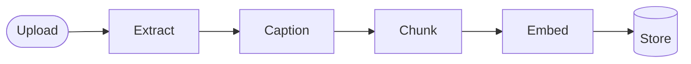
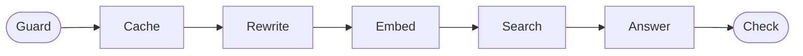

# RAG Starter Kit

A small, complete **RAG** (Retrieval-Augmented Generation) app for learning.
Upload documents, ask questions, and get answers **from your documents, with sources**.

- **Backend:** Python, FastAPI, Postgres + pgvector, Gemini
- **Frontend:** React, one page
- **You set only two things:** `DATABASE_URL` and `GEMINI_API_KEY`

---

## Quick start

```bash
git clone https://github.com/princegupta1131/rag-starter-kit.git
cd rag-starter-kit
make setup
```

Put your two values in `backend/.env`, then:

```bash
make check
make run
```

Open <http://localhost:5173>

New to this? Follow the step-by-step **[Setup Guide](docs/SETUP_GUIDE.md)** (includes Windows).

---

## How it works

### Ingestion: content in



| Step | What it does |
|---|---|
| 1. Extract | Gets text from PDF, Word, TXT, Markdown, CSV, JSON, HTML |
| 2. Caption | Describes images with Gemini so they become text |
| 3. Chunk | Splits text into small overlapping pieces |
| 4. Embed | Turns each piece into a vector (numbers that capture meaning) |
| 5. Store | Saves pieces + vectors in Postgres, ready to search |

### Retrieval: question to answer



| Step | What it does |
|---|---|
| 1. Guard | Blocks empty, too long or unsafe questions |
| 2. Cache | Returns a saved answer if the question was asked before |
| 3. Rewrite | Fixes typos and completes follow-up questions |
| 4. Embed | Turns the question into a vector |
| 5. Search | Finds matching pieces by meaning **and** by keywords |
| 6. Answer | Says "not found" if nothing matches well; otherwise Gemini answers using only those pieces |
| 7. Check | Makes sure the answer cites real sources |

In the app, every document and every answer shows these steps with what happened and how long each took.

---

## Project structure

```
rag-starter-kit/
├── backend/
│   ├── .env.example            your settings (copy to .env)
│   ├── sql/schema.sql          database tables (created automatically)
│   └── app/
│       ├── ingestion_service/  content in   (steps/step1 … step5)
│       ├── retrieval_service/  answers out  (steps/step1 … step7, prompts/)
│       └── shared/             database, Gemini, step trace
├── frontend/src/features/
│   ├── ingestion/              left panel: upload
│   └── retrieval/              right panel: chat
├── docs/SETUP_GUIDE.md
├── sample-docs/                a practice document
└── Makefile                    make setup / check / run
```

Each step is its own file, named in order (`step1_extract.py`, `step2_caption.py`, …), with a short note at the top explaining what it does.

---

## Where to change what

| I want to… | Change |
|---|---|
| Change the assistant's rules or tone | `backend/app/retrieval_service/prompts/answer_system.md` |
| Change chunk size | `CHUNK_SIZE_WORDS` in `.env` (then re-upload) |
| Be stricter or looser about "not found" | `MIN_SIMILARITY` in `.env` |
| Send more or fewer pieces to Gemini | `TOP_K` in `.env` |
| Use a different Gemini model | `CHAT_MODEL` in `.env` |
| Use another LLM provider | `backend/app/shared/gemini.py` |
| Support a new file type | `backend/app/ingestion_service/steps/step1_extract.py` |
| Add a safety rule | `backend/app/retrieval_service/steps/step1_guard.py` |

All settings and their defaults are listed in `backend/.env.example`. Restart `make run` after changing `.env`.

---

## Hands-on exercises

1. **Chunk size:** set `CHUNK_SIZE_WORDS=60`, re-upload, and compare answers. Then try `400`.
2. **"Not found" threshold:** ask something off-topic. Try `MIN_SIMILARITY=0.3`, then `0.8`.
3. **Follow-ups:** ask "until when?" after a question. Compare `QUERY_REWRITE=true` and `false`.
4. **Keyword search:** ask for an exact word like "TravelDesk" and check the Search step.
5. **Prompts:** edit `prompts/answer_system.md` (e.g. "answer in 2 sentences"). No restart needed.
6. **Languages:** ask in Hindi about the English sample document.
7. **Build a step:** add a step between Chunk and Embed that adds keywords to each piece.

---

## API

| Method | Path | Purpose |
|---|---|---|
| `GET` | `/api/health` | Is the database connected and the key set? |
| `POST` | `/api/documents` | Upload files |
| `POST` | `/api/documents/text` | Add pasted text |
| `GET` | `/api/documents` | List documents and their status |
| `GET` | `/api/documents/{id}/chunks` | See a document's pieces |
| `DELETE` | `/api/documents/{id}` | Delete a document |
| `POST` | `/api/chat` | Ask a question |

Interactive docs: <http://localhost:8000/docs> (while the app is running).

---

## Problems?

See **[Setup Guide → Problems](docs/SETUP_GUIDE.md#problems)**. Two more you may hit:

| Error | Fix |
|---|---|
| Every answer says "not found" | Open **How this answer was made**, check *best similarity*, and lower `MIN_SIMILARITY` |
| `404 model not found` | Pick a current model from <https://ai.google.dev/gemini-api/docs/models> and set `CHAT_MODEL` |

---

## From starter to production

| This kit | A production RAG usually adds |
|---|---|
| Background task in FastAPI | A job queue (Celery, Redis) |
| Text files and images | OCR for scans, speech-to-text for audio and video |
| In-memory cache | A shared cache (Redis) that also matches reworded questions |
| Simple safety rules | A classifier for unsafe or urgent questions |
| Manual testing | A test set of questions run on every change |
